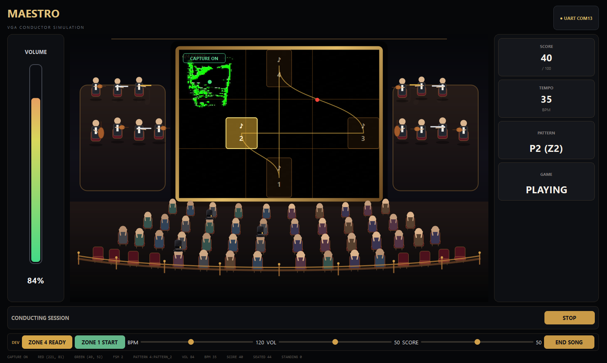

# FPGA VGA Conductor Game

> **Team Project · 2026.08.31 - 2026.09.08**  
> 실제 소스 코드와 공동 작업 이력은 [원본 팀 저장소](https://github.com/realisshoon/fpga-vga-conductor-game)에서 확인할 수 있습니다.

## Project Summary

OV7670 카메라에서 입력된 영상을 FPGA에서 처리해 빨간색 지휘봉과 초록색 손 표식의 좌표를 추출하고, 지휘 패턴·속도·음량·점수를 계산한 뒤 UART로 Python PC 애플리케이션과 연동한 실시간 지휘 시뮬레이션 게임입니다.

FPGA는 영상 기반 좌표 추출과 게임 제어를 담당하고, PC 애플리케이션은 MAESTRO 무대 UI, MIDI 재생, 영상 캡처, 관객 연출과 결과 화면을 담당하도록 역할을 분리했습니다.

[Original Team Repository](https://github.com/realisshoon/fpga-vga-conductor-game) · [Demo Video](https://github.com/realisshoon/fpga-vga-conductor-game/blob/main/docs/demo/%EC%A7%80%ED%9C%98%EA%B2%8C%EC%9E%84%20%EC%8B%9C%EC%97%B0%EC%98%81%EC%83%81.mp4) · [Final Presentation](https://github.com/realisshoon/fpga-vga-conductor-game/blob/main/docs/ppt/3%ED%8C%80_%EC%A7%80%ED%9C%98%EC%8B%9C%EB%AE%AC%EB%A0%88%EC%9D%B4%EC%85%98%EA%B2%8C%EC%9E%84.pdf)

## Demo


### 군집화 적용 후 좌표 출력 및 PC UI 연동



지휘봉·손 표식 이외의 빨강·초록 물체가 함께 검출되는 문제에 대응해 군집화를 적용했습니다. 산출한 좌표를 PC로 전달하여 검출 영상 위에 표시한 결과입니다. 이 이미지는 적용 후 동작 화면이며, 개선 전후의 정량 비교 결과는 아닙니다.

## System Flow

```text
OV7670 Camera
    ↓
Frame Buffer / VGA
    ↓
RGB Filter
    ↓
XY Detection
    ↓
Game Logic
    ├─ Pattern FSM
    ├─ Speed / Volume
    ├─ Song Decoder
    └─ Score
    ↓
UART Wrapper
    ↓
Python MAESTRO UI / MIDI / Capture
```

| Area | Implementation |
|---|---|
| Camera / Video | OV7670, 320×240 frame processing, VGA 640×480 output |
| Object Tracking | RED/GREEN color detection, clustering, Bounding Box center coordinate |
| Game Logic | 4-beat Zone FSM, tempo, volume, score, song selection |
| Communication | Ready/Valid based internal transfer, UART PC link |
| PC Application | PySide6 MAESTRO UI, MIDI playback, Capture ON/OFF, result scene |
| Verification | Module TB + team-level UVM verification |

## My Contribution

### 1. `xy_detection` RTL Design & Verification

- RED/GREEN 검출 픽셀을 프레임 단위로 누적해 Bounding Box Min/Max 계산
- 지휘봉·손 표식 이외의 RED/GREEN 물체가 함께 검출되는 문제에 대응해 군집화 적용
- Stick/Hand 중심 좌표 계산과 미검출 좌표 처리
- `xy_control_ready/valid` 기반 좌표 전달 Handshake 구성
- 다음 프레임 시작 전에 좌표 계산을 마치도록 내부 동기 펄스(가상 VSYNC)를 구성하고, 다른 모듈에 좌표를 전달하는 기준 신호로 사용
- 좌표 계산 완료·전달·다음 프레임 초기화 시점을 분리
- 이전 프레임 좌표가 다음 프레임에 전달되던 **Frame Delay 문제를 발견하고 갱신 타이밍 수정**
- `xy_detection` Testbench 수정 및 Stick/Hand 좌표 출력 검증

Source: [`xy_detection.sv`](https://github.com/realisshoon/fpga-vga-conductor-game/blob/main/rtl/filter_detect/xy_detection.sv)

### 2. `song_decoder` RTL Design & Verification

- PC 상태와 선택 곡 정보를 FPGA 게임 로직에 전달하는 `song_decoder` 설계
- 5곡 SONG 번호 Mapping 및 곡별 기준 BPM 출력 구성
- `song_decoder` Testbench 작성과 곡 선택·BPM 출력 동작 검증

Source: [`song_decoder.sv`](https://github.com/realisshoon/fpga-vga-conductor-game/blob/main/rtl/game/song_decoder.sv)

### 3. FPGA-PC Interface & MAESTRO UI

- Python 기반 MAESTRO 게임 UI 구조와 화면 Layout 구성
- MAIN → MENU → READY → PLAYING → RESULT Scene 흐름 연동
- 5곡 MIDI 구성 및 곡 선택 UI·Protocol 연동
- CAPTURE OFF 환경에서 Stick/Hand 가상 입력 시각화
- Capture Manager와 MAESTRO UI 영상 입력 연동
- FPGA의 **320×240 좌표와 PC의 640×480 영상 간 좌표 대응 방식** 정리
- UART MOCK/REAL 모드와 PC-FPGA 연동 규격 정리

### 4. Conducting Speed Function Specification

속도 계산 RTL 전체 구현을 개인 기여로 주장하지 않고, 초기 기능 설계 단계에서 담당한 범위만 구분했습니다.

- 지휘봉 속도 계산 기능 요구사항 정의
- `stick_speed_calc` 역할·입출력·비트폭·계산 타이밍 정의
- 프레임 기반 지휘 좌표 입력과 이전 좌표 저장 구조 설계
- 좌표 차이 기반 속도 산출 방식 및 UART Ready/Valid 전달 규격 정의

## Design Decisions

| Decision | Reason |
|---|---|
| Clustering | 표식 외의 RED/GREEN 물체도 함께 검출되어 좌표 산출에 영향을 주는 문제에 대응 |
| Coordinate synchronization pulse | 다음 프레임 전에 계산을 완료하고, 내부 동기 펄스를 기준으로 다른 모듈에 좌표를 전달 |
| Bounding Box center | 검출된 색상 영역의 Min/Max 범위를 이용해 단일 Pixel이 아닌 객체 중심을 지휘 입력으로 사용 |
| Ready/Valid handshake | 후단 모듈이 좌표를 수신할 때까지 유효한 데이터를 유지하도록 전달 조건 구성 |
| FPGA / PC role separation | 실시간 좌표·게임 판정은 FPGA, UI·MIDI·영상 연출은 PC가 담당해 각 플랫폼의 역할을 분리 |

## Verification & Troubleshooting

### Individual Scope

- `xy_detection` 좌표 출력 Testbench
- `song_decoder` 곡 선택·BPM 출력 Testbench
- Frame Delay 문제 재현 및 좌표 갱신 타이밍 수정
- QVGA 좌표와 VGA/PC 표시 좌표 간 Scale 차이 확인 및 연동 규격 정리

### Team-level Verification

최종 팀 시스템에서는 RG Detect, Game Logic, UART Wrapper를 대상으로 UVM Scoreboard, Functional Coverage, Assertion 기반 검증을 수행했습니다. 이 항목은 **팀 전체 검증 결과**이며 개인 담당 범위와 구분합니다.

## Result

카메라 영상에서 추출한 지휘봉·손 좌표를 FPGA 게임 로직과 PC 애플리케이션까지 연결하면서, **Frame 단위 영상 데이터 → RTL 좌표 처리 → Handshake → UART → UI/MIDI**로 이어지는 시스템에서 좌표 처리 RTL과 PC UI 연동을 담당했습니다.

특히 `xy_detection`의 Frame Delay와 QVGA/VGA 좌표 기준 차이를 직접 확인하면서, 기능 구현뿐 아니라 **모듈 간 Timing과 Interface 기준을 맞추는 과정이 시스템 통합에서 중요하다는 점**을 경험했습니다.

## Repository & Ownership

- **Original Team Repository:** [realisshoon/fpga-vga-conductor-game](https://github.com/realisshoon/fpga-vga-conductor-game)
- **Project Type:** 7-person Team Project
- 이 디렉터리는 개인 포트폴리오용 설명 문서이며 팀 소스 코드를 복사하지 않았습니다.
- 팀 전체 기능과 개인 기여를 구분해 작성했으며, 실제 RTL/Python 소스와 공동 이력은 원본 팀 저장소를 기준으로 합니다.
